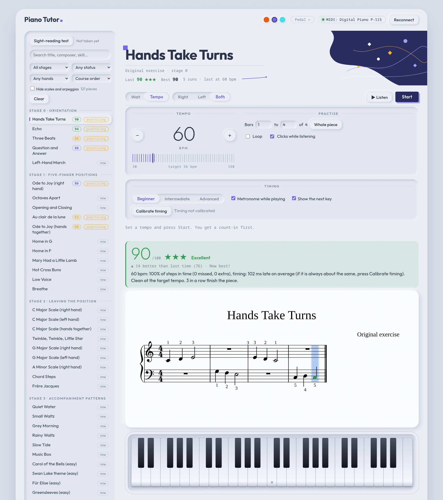
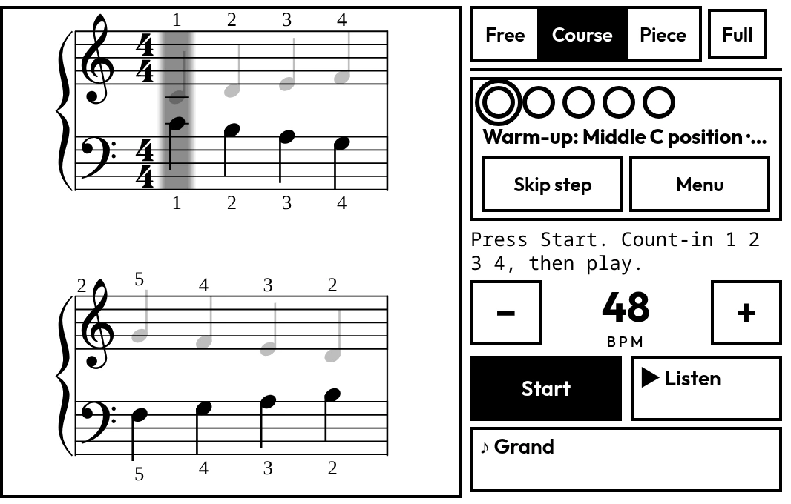
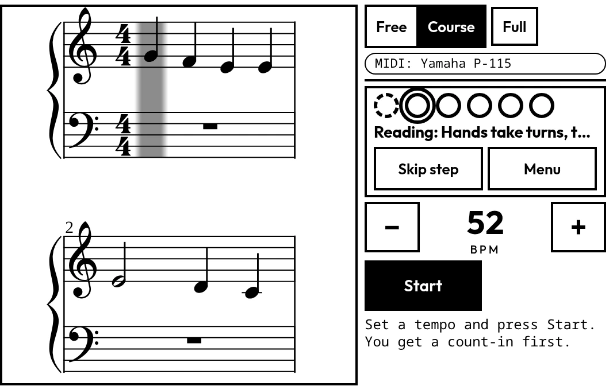
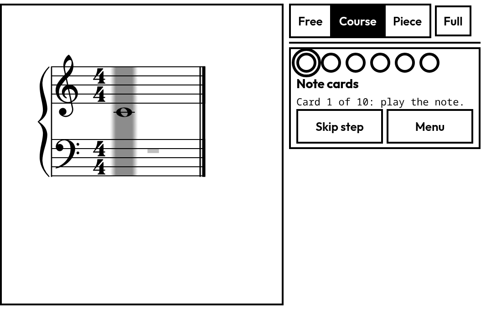
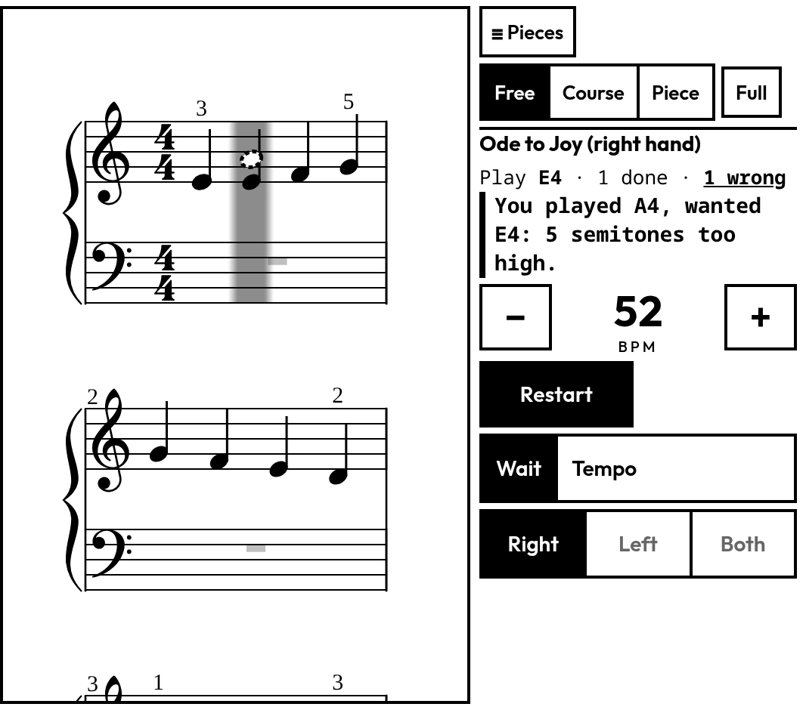
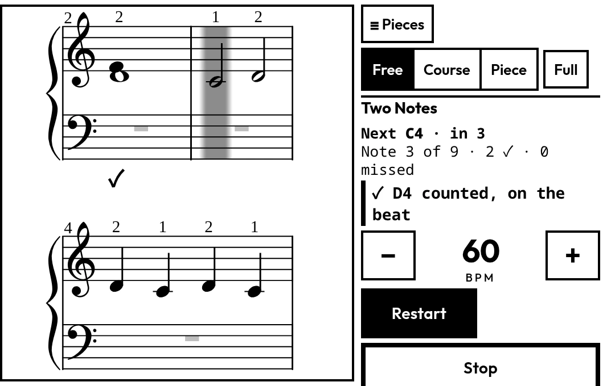
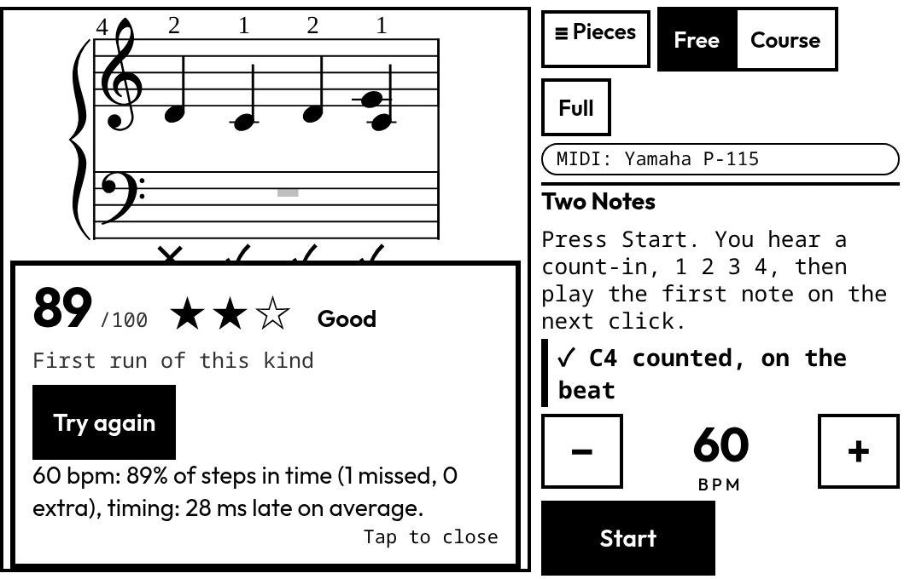
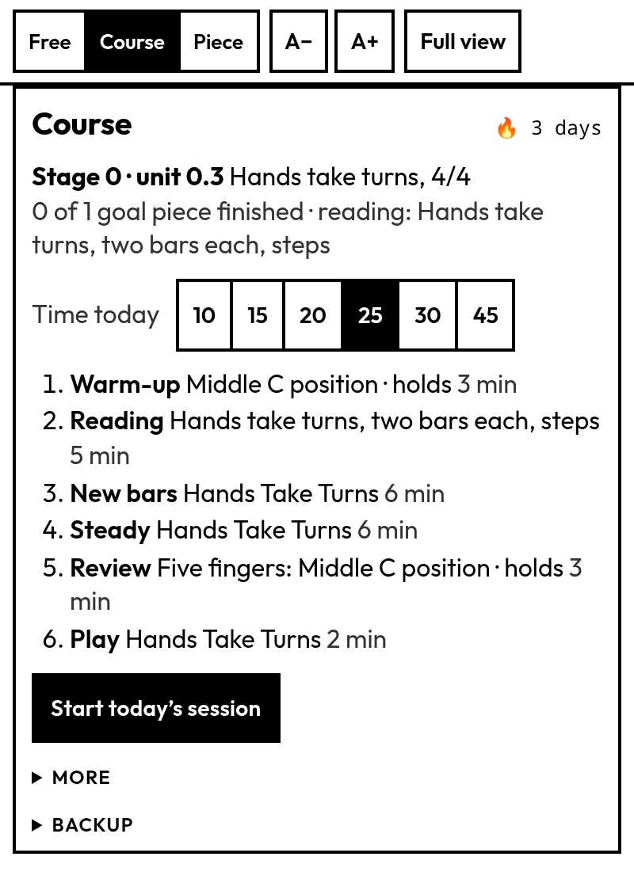
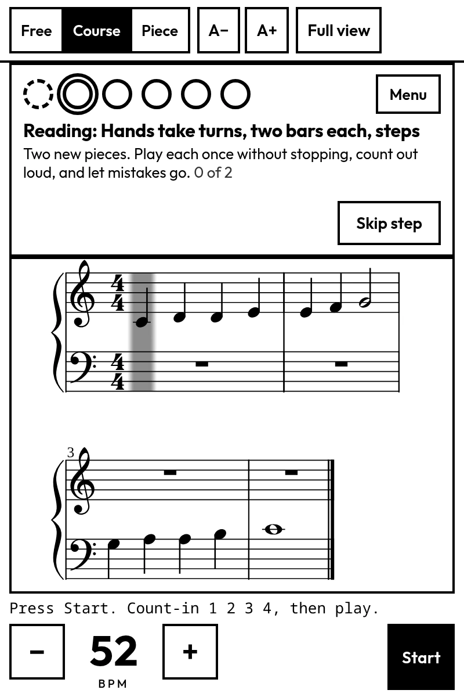

# Piano Tutor

A practice app and a self-study plan for learning piano from real sheet music, with no teacher and no subscription.

The app shows a score, listens to your keyboard over USB-MIDI, and tells you what you got right and wrong. The plan is a
set of Markdown files covering the method, a staged syllabus, repertoire, and a daily 25-minute routine, and **Course mode** turns that
routine into a session you open and play, one step at a time. Both are built for
one learner: a total beginner with a Yamaha P-115 who wants to play neoclassical and classical music. The app works with any
MIDI keyboard, and you can also play with your computer keyboard or the mouse.

> **Status:** it works and is covered by unit tests. Tempo mode has been driven by scripts with timed key presses, but not yet
> tried by a person on a real piano across different setups, so expect rough edges. Issues and suggestions are welcome.

## Screenshots

**Wait mode** (Warm theme). The cursor waits for the right notes. The notes you play appear on the staff, green when right and red when wrong, at the height of the key you pressed, with a plain explanation underneath. The line under the title is the piece's score history.


**Tempo mode** (Night theme). A metronome sets the pace and every note has a timing window. The thin line crossing the staves moves at your tempo, so you can see when to press. The key you should play next is outlined in green, and the status line counts what was in time, missed or extra.


**Scores** (Cold blues theme). Every run gets a score out of 100 and up to three stars, with how it compares to your last run and your best. The library shows the last score of each piece you have played, and the sort "Needs practice first" puts the weakest at the top. The history in these screenshots is sample data.



**Sight-reading test** (Warm theme). Freshly generated pieces in seven levels, so you never see the same one twice.


The three dots at the top right switch between the Warm, Cold blues and Night themes, and the choice is remembered. The screenshots use a stand-in for the piano connection, so the top bar shows a P-115.

## Course mode and the minimal view

**Course mode** is a daily session in the style of Duolingo: open the app, press one button, and work through today's steps. One dot per
step shows where you are. The course starts with a seven-day **introduction week** (right hand, then left, then basic exercises with
both, before any reading) and goes on through Stage 0 (the hands take turns), Stage 1 (five-finger positions, first hands together) and
the start of Stage 2. Each unit lists its own exercises, reading and note cards, and the generated reading gets harder one step at a time but never
runs ahead of the lesson ([12-lesson-ladder.md](12-lesson-ladder.md), [13-progression-review.md](13-progression-review.md)).

The **minimal view** is the same app for a small, black and white e-ink screen such as the Minimal Phone (4.3", 600×800): the score,
the tempo and Start, big buttons, no animation. Open `?view=minimal` once to bookmark it, or tap the button at the top right of the full view.
It is built for the phone on the music stand, held sideways: the score takes the whole height on the left and the controls stack in a column on the
right. Held upright it works too (last row below). The staff is drawn at the width of the screen and shrinks until two rows fit, so you always
see the line after the one you are reading, and the page turns exactly at the start of a line, never through one.

<table>
<tr>
<td width="50%"><br><sub><b>A warm-up, one hand.</b> The hand you are not asked to play is faded. The dots across the top are today's steps.</sub></td>
<td width="50%"><br><sub><b>Reading.</b> A freshly generated piece at the step the unit has reached, here the hands taking turns. Listen is off: you read it cold.</sub></td>
</tr>
<tr>
<td width="50%"><br><sub><b>Note cards</b> (Stage 0). A note appears, you play it. Under two seconds counts as fast. New notes arrive one a day.</sub></td>
<td width="50%"><br><sub><b>Free mode, wait mode.</b> What you play shows on the staff: filled when right, dashed when wrong, with no colour needed.</sub></td>
</tr>
<tr>
<td width="50%"><br><sub><b>A timed run.</b> The grey bar is the next note to play and jumps the moment you play it. The cue says which note and how many clicks away ("in 3", then NOW), and a ✓ stays under every note that counted (✕ for a missed one).</sub></td>
<td width="50%"><br><sub><b>The result.</b> Score and stars, and <b>Try again</b>, which is on every piece and exercise. Tap anywhere else on the card to close it and see your marks.</sub></td>
</tr>
</table>

<table>
<tr>
<td width="50%" align="center"><br><sub><b>The course page.</b> Your streak, the time you have today (10 to 45 minutes) and the steps.</sub></td>
<td width="50%" align="center"><br><sub><b>Held upright.</b> The same reading step in portrait.</sub></td>
</tr>
</table>

These screenshots show only the app's own exercises and generated pieces, with a stand-in for the piano connection and sample course history.
`node tools/screenshots/minimal.mjs` takes them again (see its header).

## Piece mode

The **Piece** switch at the top works one score until it is done: the app finds the easy and hard parts of each hand, then takes you from the notes the piece uses, through each hand alone, a few bars with both hands, and the trouble spots, up to the whole piece with the metronome. Details: [14-piece-mode.md](14-piece-mode.md).

## What the app does

- **Reads real notation.** It loads MusicXML (`.mxl`, `.musicxml`) and draws it with
  [OpenSheetMusicDisplay](https://opensheetmusicdisplay.org/), with a cursor on the current step.
- **Wait mode.** The cursor stays put until you play exactly the right notes. Chords can be played in any order. Use it to learn a piece.
- **Notes on the staff.** A right key shows up as a green note that fades after a moment. A wrong key shows up as a red note on the staff at the cursor (with ledger lines and a sharp sign where needed), so you see at what height you played, not just a message. It works before you press Start too: in tempo mode the key is checked against the first notes of the piece (or your bar range) for the hand you chose, with no clock and no score.
- **Tempo mode.** After a count-in, the score follows a metronome and each note has a timing window. You get the share of notes played
  in time, missed and extra notes, and whether you rush or drag. After a clean run the tempo rises 4 bpm. Three clean runs at the target tempo finish the piece.
  The tempo counts the piece's own beat, so 6/8 is counted in dotted quarters. A line slides across the score at the tempo: press each key as the line reaches its note. A level setting (Beginner, Intermediate, Advanced) sets how wide the timing window is, from about half a beat either side down to a strict ±150 ms at most.
- **Try again.** Every result card has a **Try again** button, for every piece and exercise (wait or tempo, free or in the course): wait mode starts again from the first note, tempo mode from a fresh count-in, as often as you like. Every run is logged. In the course, a second go at the same generated reading piece is practice and does not count towards the step; the sight-reading test is one try on purpose.
- **Listen.** Plays the piece (one hand or both) after a count-in, with the cursor and the keys lit, so you can hear the rhythm before you try it.
- **Bar ranges and looping.** Practise bars 5 to 8 only, and loop them at a rising tempo.
- **Tempo readout.** A big thin numeral with − and + buttons and a tick ruler that fills up to your tempo, with a notch at the piece's target.
- **Hand selection.** Practise the right hand, the left hand, or both. The app plays the other hand.
- **Sight-reading test.** Seven levels of freshly generated pieces you can't have seen. 80% in time passes a level.
- **Latency calibration.** Tap along to a click and the app corrects for your keyboard's delay.
- **Scales and arpeggios.** Generated for 23 keys, with fingering, run through the same tempo ladder.
- **Scores.** Every run gets a 0–100 score and up to three stars, with how it compares to your last run and your best. Under each piece's title you see last score, best, run count and a sparkline; the library shows each piece's last score, and "Needs practice first" sorts the weakest to the top.
- **Practice log.** Every run is saved in your browser, and each piece is marked new, practicing or done.
- **Library search.** Filter by title, composer, skill, stage or status, and sort by course order or difficulty.
- **Course mode.** A daily session built from the syllabus: warm-up, reading, new bars, a steady run, review and play, scaled to 10, 15, 20, 25, 30 or 45 minutes. It adapts: reading climbs after two good days, units end when their exit is met, and a streak counts the days. It starts with a seven-day introduction week. Progress can be saved to a file and loaded back (**Backup**).
- **Reading ladder.** The Reading step is a generated piece from a ladder of 28 rungs, each adding one thing (one new note, a skip, a meter, a rhythm), tied to the unit you are in, so it never asks for something the lessons have not shown.
- **Note cards.** In Stage 0, a note on the staff that you play within two seconds; the deck grows with the units and shows new notes more often.
- **Minimal view.** A black and white layout for small and e-ink screens (see above), with a paged score instead of scrolling.
- **Adding music.** Drop MusicXML files in `inbox/` and run one script. It checks each file, rates its difficulty, assigns a stage and rejects duplicates and pop.

All the grading runs in your browser. There is no server, no account and no network use after the page loads.

## Quick start

You need a current Node.js (developed on 24) and Chrome or Edge, because Web MIDI isn't in Safari and Firefox needs a permission prompt.

```bash
git clone <this repo>
cd piano-tutor/app
npm install
npm run dev        # https://localhost:5173 (a self-signed certificate: accept the browser's warning once)
```

`npm run dev` serves over **https** on every network address, because Web MIDI only works on a secure page: that lets a phone on the same wifi open
`https://<your laptop's address>:5173/?view=minimal` and use its own USB-MIDI. `npm run dev:http` is the plain `http://localhost:5173` server.

Plug in a MIDI keyboard before you open the page. The device name appears in the top bar and the pedal value is shown live.
With no keyboard, play with the computer keys (shown in the sidebar) or click the on-screen keys.

```bash
npm test           # unit tests (vitest)
npm run build      # typecheck + production build into app/dist
```

### Yamaha P-115 notes

The piano sends note-off as Note On with velocity 0, and floods the port with Active Sensing and Clock messages. The MIDI layer handles
both. For the sustain pedal to arrive, the panel's **Control Change** setting must be on. [07-setup-p115.md](07-setup-p115.md) has the
steps, and [tools/midi-check.html](tools/midi-check.html) is a stand-alone page that shows exactly what your piano sends.

## Sheet music

This repository contains **no copyrighted sheet music**.

- **Built in:** 38 short lessons, 20 five-finger warm-ups and 46 scale and arpeggio exercises, all original or public domain, written in a compact notation
  (`C4:q/1 D4:q/2 E4:h/3 |`) that the tests check bar by bar.
- **Included files:** two MusicXML files that state they are public domain (Bach, Minuet in G; Chopin, Prelude in E minor).
- **Your own scores:** `app/scores/library.json` lists a larger library, but entries whose file is missing are skipped. Add the files
  yourself, from [IMSLP](https://imslp.org/), [OpenScore](https://musescore.com/openscore) or your own MuseScore exports, and the
  entries appear. Only add what you have the right to use, and check each file's licence.

To turn a PDF of a book you own into MusicXML on your own computer, `tools/omr/` wraps an optical music recognition model ([homr](https://github.com/liebharc/homr))
with the checks that make its output usable (bars that add up, hands in the right voices, a comparison against the page). The converted files stay local and are
never committed. See [tools/omr/README.md](tools/omr/README.md) and [11-ingestion-ledger.md](11-ingestion-ledger.md), which records what is converted and what is missing.

To add scores:

```bash
# put .mxl / .musicxml / .zip files in inbox/, then from the repo root:
./ingest.sh            # report only: verdict, difficulty and stage for each file
./ingest.sh --apply    # register the new ones, run the tests, file the results
```

Each file is checked for readability and for bars that don't fill the time signature, rated for difficulty (stages 3 to 6), and compared
with the library. Duplicates are never overwritten. Composers outside the classical and neoclassical list are held for review, because this
project excludes pop arrangements on purpose. See [inbox/README.md](inbox/README.md). In Claude Code, the `import-scores` skill in `.claude/skills/` runs the same steps.

## The learning plan

The plan is a series of short documents. The app follows them but doesn't depend on them.

| File | What's in it |
|---|---|
| [01-methods.md](01-methods.md) | What made Piano Marvel work, the main methods and books compared, and the recommended spine |
| [02-syllabus.md](02-syllabus.md) | The staged curriculum: 6 stages, 5 parallel skill tracks, exit criteria per stage |
| [03-repertoire.md](03-repertoire.md) | Graded repertoire, neoclassical and classical, mapped to stages |
| [04-sheet-music-sources.md](04-sheet-music-sources.md) | Where to find scores, which formats, and the legal notes |
| [05-practice-routine.md](05-practice-routine.md) | The daily 25-minute session and how to practise a new piece |
| [06-app-notes.md](06-app-notes.md) | How the plan maps onto the app, and the roadmap |
| [07-setup-p115.md](07-setup-p115.md) | What the P-115 sends over USB-MIDI, and its panel settings |
| [08-videos.md](08-videos.md) | Checked YouTube links on posture, practice, hands together, sight-reading and pedal |
| [09-library-catalog.md](09-library-catalog.md) | What each method book is for, by stage |
| [10-course-mode-plan.md](10-course-mode-plan.md) | The plan for Course mode and how it was built |
| [11-ingestion-ledger.md](11-ingestion-ledger.md) | Which books are converted to MusicXML and which are still missing |
| [12-lesson-ladder.md](12-lesson-ladder.md) | The units: the introduction week, then Stages 0 to 2, with their pieces, exercises and exits |
| [13-progression-review.md](13-progression-review.md) | The review that tied generated content to the lessons, with the books and research behind it |

The core idea is to use one published adult method as the spine (Faber *Adult Piano Adventures*, then a graded syllabus), read new music
every day, bring in pieces you love early, and let the app be the feedback loop rather than the curriculum. The plan refers to commercial
books by name. They aren't included, so you need your own copies.

## Project layout

```
app/                    Vite + TypeScript app
  src/midi/             Web MIDI parsing and the single input bus (piano, keyboard, mouse)
  src/practice/         Wait mode, tempo mode, timeline, calibration, ranges, log, sight-reading test
  src/content/          Notation compiler, MXL reader, built-in lessons, technique generator, reading ladder, score manifest
  src/ui/               Score view (paged and fitted in the minimal view), on-screen keyboard, synth, library filter, view switch
  src/course/           Course mode: state, day planner, note cards, the course page
  src/storage/          Backup and restore of everything the app remembers
  course/course.json    The units: exercises, reading rungs, cards, exits
  scores/library.json   Manifest of imported scores (files are not tracked)
tools/                  import-scores.py, score-difficulty.py, midi-check.html, ledger.py
tools/omr/              PDF to MusicXML (homr plus checks), local only
tools/screenshots/      Takes the minimal-view screenshots for this README
docs/screenshots/       The images above
inbox/                  Drop new scores here, then run ./ingest.sh
.claude/skills/         The import-scores skill for Claude Code
0X-*.md                 The learning plan
```

The timing and scoring logic takes timestamps as input rather than reading the clock, so it is unit-tested without a browser or a piano.
The app README ([app/README.md](app/README.md)) has the module-by-module detail.

## Roadmap

Wait mode, tempo mode, hands, listen, ranges and looping, the sight-reading test, calibration, search, the import workflow, Course mode
(with its introduction week and reading ladder), the minimal view and backup files are done. The course reaches unit 2.3; the
next job is **more content**: Faber Book 1 Units 14 to 16 and four lyric-heavy pieces to transcribe by hand, then Book 2 for Stage 3 (what is converted and
what is missing is in [11-ingestion-ledger.md](11-ingestion-ledger.md)). Also open: a finer placement test, a rhythm-only step before reading, a history page, and
storage more durable than the browser (the backup file is the safeguard for now). Ideas that haven't been scheduled: clicking the score to set a bar range, pedal marks in Listen, and
an import tool for single [Mutopia](https://www.mutopiaproject.org/) pieces. Things that were considered and dropped, with the reasons, are listed in
[06-app-notes.md](06-app-notes.md).

## Contributing

Bug reports and ideas are welcome. Please don't attach copyrighted scores to issues or pull requests. If you add a piece to the built-in lessons, it must be
original or public domain, and `npm test` must pass: it rejects any bar whose durations don't add up.

## Credits and licence

Code and written plan: [MIT](LICENSE). Sheet music you add keeps its own licence.

Built with [OpenSheetMusicDisplay](https://github.com/opensheetmusicdisplay/opensheetmusicdisplay), [JSZip](https://stuk.github.io/jszip/),
[Vite](https://vite.dev/), [TypeScript](https://www.typescriptlang.org/) and [Vitest](https://vitest.dev/). The scale-and-arpeggio idea came from
reading piano-ml, a GPL-3.0 project. No code was copied from it. `tools/omr/` installs [homr](https://github.com/liebharc/homr) (AGPL-3.0) as a separate local tool; it is not part of this repository.
