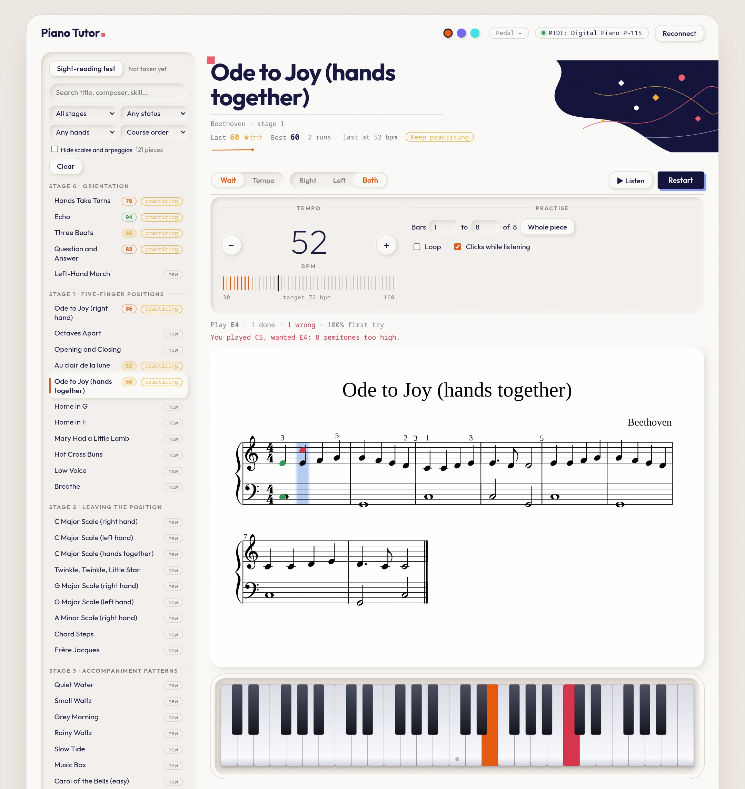
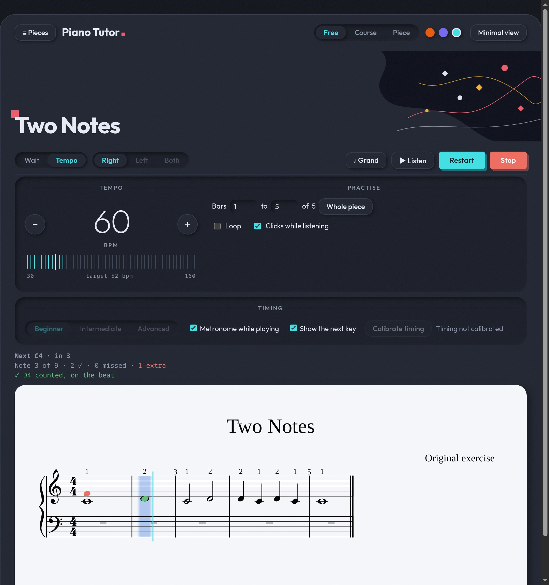
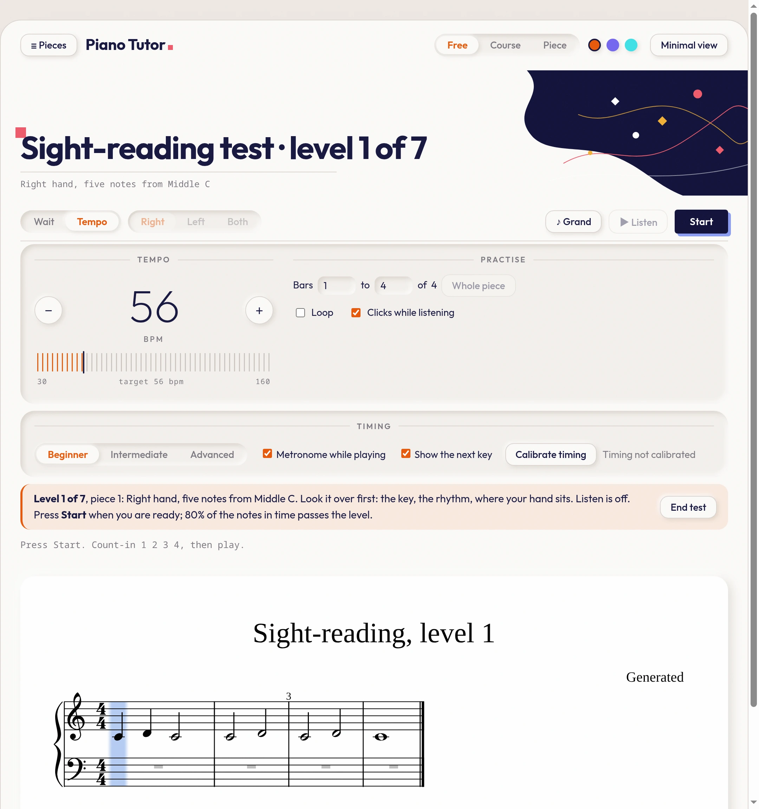

# Piano Tutor

A practice app and a self-study plan for learning piano from real sheet music, with no teacher and no subscription.

The app shows a score, listens to your keyboard over USB-MIDI, and tells you what you got right and wrong. The plan is a
set of Markdown files covering the method, a staged syllabus, repertoire, and a daily 25-minute routine. Both are built for
one learner: a total beginner with a Yamaha P-115 who wants to play neoclassical and classical music. The app works with any
MIDI keyboard, and you can also play with your computer keyboard or the mouse.

> **Status:** it works and is covered by unit tests. Tempo mode has been driven by scripts with timed key presses, but not yet
> tried by a person on a real piano across different setups, so expect rough edges. Issues and suggestions are welcome.

## Screenshots

**Wait mode** (Warm theme). The cursor waits for the right notes. A wrong key gets a plain explanation, and the keyboard shows what you played.



**Tempo mode** (Night theme). A metronome sets the pace and every note has a timing window. The key you should have played is outlined in green, and the status line counts what was in time, missed or extra.



**Sight-reading test** (Cold blues theme). Freshly generated pieces in seven levels, so you never see the same one twice.



The three dots at the top right switch between the Warm, Cold blues and Night themes, and the choice is remembered. The screenshots use a stand-in for the piano connection, so the top bar shows a P-115.

## What the app does

- **Reads real notation.** It loads MusicXML (`.mxl`, `.musicxml`) and draws it with
  [OpenSheetMusicDisplay](https://opensheetmusicdisplay.org/), with a cursor on the current step.
- **Wait mode.** The cursor stays put until you play exactly the right notes. Chords can be played in any order. Use it to learn a piece.
- **Wrong notes on the staff.** A wrong key shows up as a red note on the staff at the cursor (with ledger lines and a sharp sign where needed), so you see at what height you played, not just a message.
- **Tempo mode.** After a count-in, the score follows a metronome and each note has a timing window. You get the share of notes played
  in time, missed and extra notes, and whether you rush or drag. After a clean run the tempo rises 4 bpm. Three clean runs at the target tempo finish the piece.
  The tempo counts the piece's own beat, so 6/8 is counted in dotted quarters.
- **Listen.** Plays the piece (one hand or both) after a count-in, with the cursor and the keys lit, so you can hear the rhythm before you try it.
- **Bar ranges and looping.** Practise bars 5 to 8 only, and loop them at a rising tempo.
- **Tempo readout.** A big thin numeral with − and + buttons and a tick ruler that fills up to your tempo, with a notch at the piece's target.
- **Hand selection.** Practise the right hand, the left hand, or both. The app plays the other hand.
- **Sight-reading test.** Seven levels of freshly generated pieces you can't have seen. 80% in time passes a level.
- **Latency calibration.** Tap along to a click and the app corrects for your keyboard's delay.
- **Scales and arpeggios.** Generated for 23 keys, with fingering, run through the same tempo ladder.
- **Practice log.** Every run is saved in your browser, and each piece is marked new, practicing or done.
- **Library search.** Filter by title, composer, skill, stage or status, and sort by course order or difficulty.
- **Adding music.** Drop MusicXML files in `inbox/` and run one script. It checks each file, rates its difficulty, assigns a stage and rejects duplicates and pop.

All the grading runs in your browser. There is no server, no account and no network use after the page loads.

## Quick start

You need a current Node.js (developed on 24) and Chrome or Edge, because Web MIDI isn't in Safari and Firefox needs a permission prompt.

```bash
git clone <this repo>
cd piano-tutor/app
npm install
npm run dev        # open http://localhost:5173
```

Plug in a MIDI keyboard before you open the page. The device name appears in the top bar and the pedal value is shown live.
With no keyboard, play with the computer keys (shown in the sidebar) or click the on-screen keys.

```bash
npm test           # unit tests (vitest)
npm run build      # typecheck + production build into app/dist
```

### Yamaha P-115 notes

The piano sends note-off as Note On with velocity 0, and floods the port with Active Sensing and Clock messages. The MIDI layer handles
both. For the sustain pedal to arrive, the panel's **Control Change** setting must be on. [07-setup-p115.md](07-setup-p115.md) has the
steps, and [tools/midi-check.html](tools/midi-check.html) is a stand-alone page that shows exactly what your piano sends.

## Sheet music

This repository contains **no copyrighted sheet music**.

- **Built in:** 31 short lessons and 46 scale and arpeggio exercises, all original or public domain, written in a compact notation
  (`C4:q/1 D4:q/2 E4:h/3 |`) that the tests check bar by bar.
- **Included files:** two MusicXML files that state they are public domain (Bach, Minuet in G; Chopin, Prelude in E minor).
- **Your own scores:** `app/scores/library.json` lists a larger library, but entries whose file is missing are skipped. Add the files
  yourself, from [IMSLP](https://imslp.org/), [OpenScore](https://musescore.com/openscore) or your own MuseScore exports, and the
  entries appear. Only add what you have the right to use, and check each file's licence.

To add scores:

```bash
# put .mxl / .musicxml / .zip files in inbox/, then from the repo root:
./ingest.sh            # report only: verdict, difficulty and stage for each file
./ingest.sh --apply    # register the new ones, run the tests, file the results
```

Each file is checked for readability and for bars that don't fill the time signature, rated for difficulty (stages 3 to 6), and compared
with the library. Duplicates are never overwritten. Composers outside the classical and neoclassical list are held for review, because this
project excludes pop arrangements on purpose. See [inbox/README.md](inbox/README.md). In Claude Code, the `import-scores` skill in `.claude/skills/` runs the same steps.

## The learning plan

The plan is a series of short documents. The app follows them but doesn't depend on them.

| File | What's in it |
|---|---|
| [01-methods.md](01-methods.md) | What made Piano Marvel work, the main methods and books compared, and the recommended spine |
| [02-syllabus.md](02-syllabus.md) | The staged curriculum: 6 stages, 5 parallel skill tracks, exit criteria per stage |
| [03-repertoire.md](03-repertoire.md) | Graded repertoire, neoclassical and classical, mapped to stages |
| [04-sheet-music-sources.md](04-sheet-music-sources.md) | Where to find scores, which formats, and the legal notes |
| [05-practice-routine.md](05-practice-routine.md) | The daily 25-minute session and how to practise a new piece |
| [06-app-notes.md](06-app-notes.md) | How the plan maps onto the app, and the roadmap |
| [07-setup-p115.md](07-setup-p115.md) | What the P-115 sends over USB-MIDI, and its panel settings |
| [08-videos.md](08-videos.md) | Checked YouTube links on posture, practice, hands together, sight-reading and pedal |
| [09-library-catalog.md](09-library-catalog.md) | What each method book is for, by stage |

The core idea is to use one published adult method as the spine (Faber *Adult Piano Adventures*, then a graded syllabus), read new music
every day, bring in pieces you love early, and let the app be the feedback loop rather than the curriculum. The plan refers to commercial
books by name. They aren't included, so you need your own copies.

## Project layout

```
app/                    Vite + TypeScript app
  src/midi/             Web MIDI parsing and the single input bus (piano, keyboard, mouse)
  src/practice/         Wait mode, tempo mode, timeline, calibration, ranges, log, sight-reading test
  src/content/          Notation compiler, MXL reader, built-in lessons, technique generator, score manifest
  src/ui/               Score view, on-screen keyboard, synth, library filter
  scores/library.json   Manifest of imported scores (files are not tracked)
tools/                  import-scores.py, score-difficulty.py, midi-check.html
inbox/                  Drop new scores here, then run ./ingest.sh
.claude/skills/         The import-scores skill for Claude Code
0X-*.md                 The learning plan
```

The timing and scoring logic takes timestamps as input rather than reading the clock, so it is unit-tested without a browser or a piano.
The app README ([app/README.md](app/README.md)) has the module-by-module detail.

## Roadmap

Wait mode, tempo mode, hands, listen, ranges and looping, the sight-reading test, calibration, search and the import workflow are done.
Ideas that haven't been scheduled: clicking the score to set a bar range, a tempo ladder that resumes where you left off, pedal marks in Listen, and
an import tool for single [Mutopia](https://www.mutopiaproject.org/) pieces. Things that were considered and dropped, with the reasons, are listed in
[06-app-notes.md](06-app-notes.md).

## Contributing

Bug reports and ideas are welcome. Please don't attach copyrighted scores to issues or pull requests. If you add a piece to the built-in lessons, it must be
original or public domain, and `npm test` must pass: it rejects any bar whose durations don't add up.

## Credits and licence

Code and written plan: [MIT](LICENSE). Sheet music you add keeps its own licence.

Built with [OpenSheetMusicDisplay](https://github.com/opensheetmusicdisplay/opensheetmusicdisplay), [JSZip](https://stuk.github.io/jszip/),
[Vite](https://vite.dev/), [TypeScript](https://www.typescriptlang.org/) and [Vitest](https://vitest.dev/). The scale-and-arpeggio idea came from
reading piano-ml, a GPL-3.0 project. No code was copied from it.
